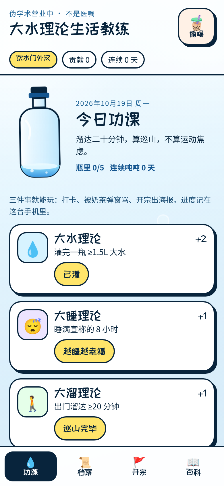
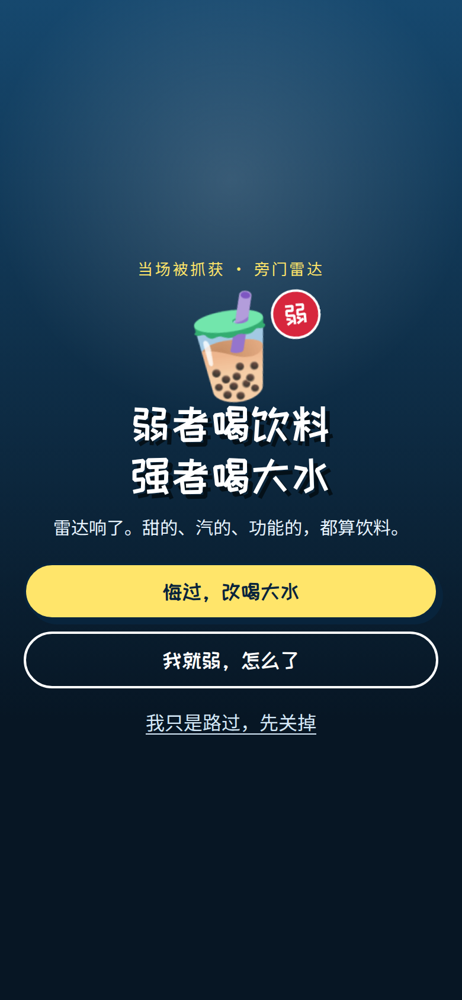
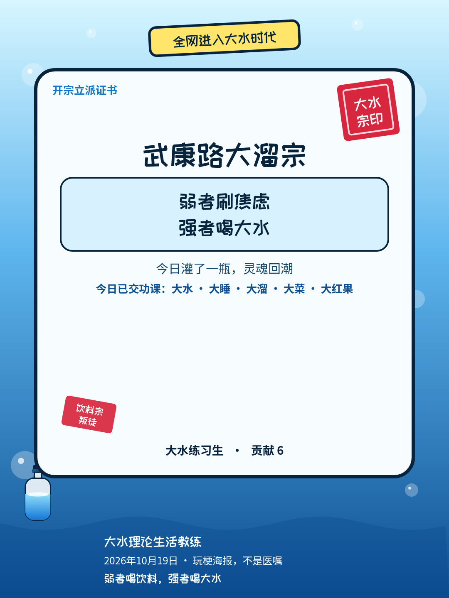
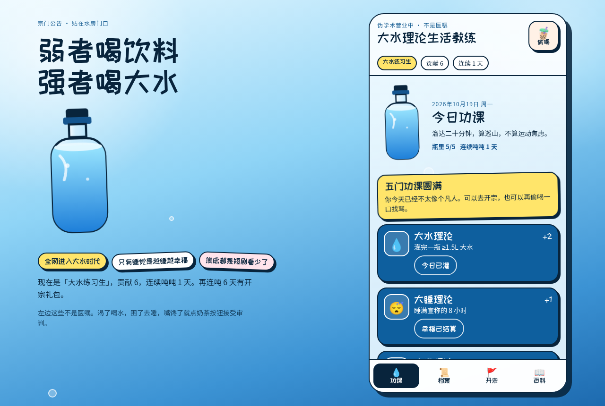

# 大水理论生活教练

弱者喝饮料，强者喝大水。

一个单页玩梗小工具：每天打卡「大理论」，偷喝奶茶会被当场阴阳，还能一键生成朋友圈开宗立派海报。没有登录，没有后端。头衔、贡献和宗门记录都记在浏览器的 `localStorage`（键名 `big-water-theory-v1`）。

这不是健康建议，也不是医嘱。渴了可以喝水，困了可以睡觉，剩下的都是梗。

## 本地运行

```bash
npm install
npm run dev
```

浏览器打开终端里打印的本地地址，默认是 [http://127.0.0.1:4731](http://127.0.0.1:4731)。

生产构建：

```bash
npm run build
npm run preview
```

## 三条玩法

1. **今日功课**  
   底部点「功课」。大水、大睡、大溜、大菜、大红果都能打卡。打完贡献值上涨，头衔从「饮水门外汉」往「大水宗主」飘。刷新还在。没做完可以点「我今天摆了」，只会轻轻阴阳一句。

2. **偷喝奶茶**  
   右上角「偷喝」，或功课页那张奶茶卡片。全屏弹窗念「弱者喝饮料，强者喝大水」。可以悔过回宗，也可以承认自己弱，拿走隐藏称号「饮料宗叛徒」。

3. **开宗立派**  
   底部点「开宗」。填宗门名、口号「弱者____，强者____」，碎碎念可空。预览海报后点「盖章并保存海报」，图片会下载（手机上可能弹出系统分享）。海报带大瓶水、伪学术印章和「全网进入大水时代」。连续打卡 7 天解锁金边框，并随机送一门衍生理论。

头衔阶梯：饮水门外汉 → 大水练习生 → 吨吨执事 → 大水长老 → 大水宗主。  
隐藏称号还有大睡真神、武康路无声舞王、短剧治愈师，打满对应功课就会盖章。

档案页底部可以「倒掉宗门记忆」。

## 界面

打开就是今日功课。右上角奶茶是诱惑按钮。



偷喝之后的全屏阴阳。可以悔过，也可以承认自己弱。



填完宗门名和口号，海报长这样，可以保存。



宽屏时左边是宗门公告，右边是同一套手机界面。


